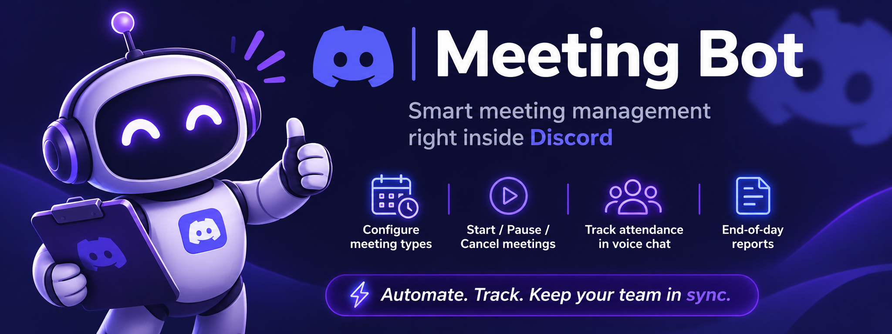
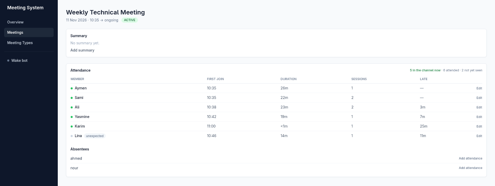
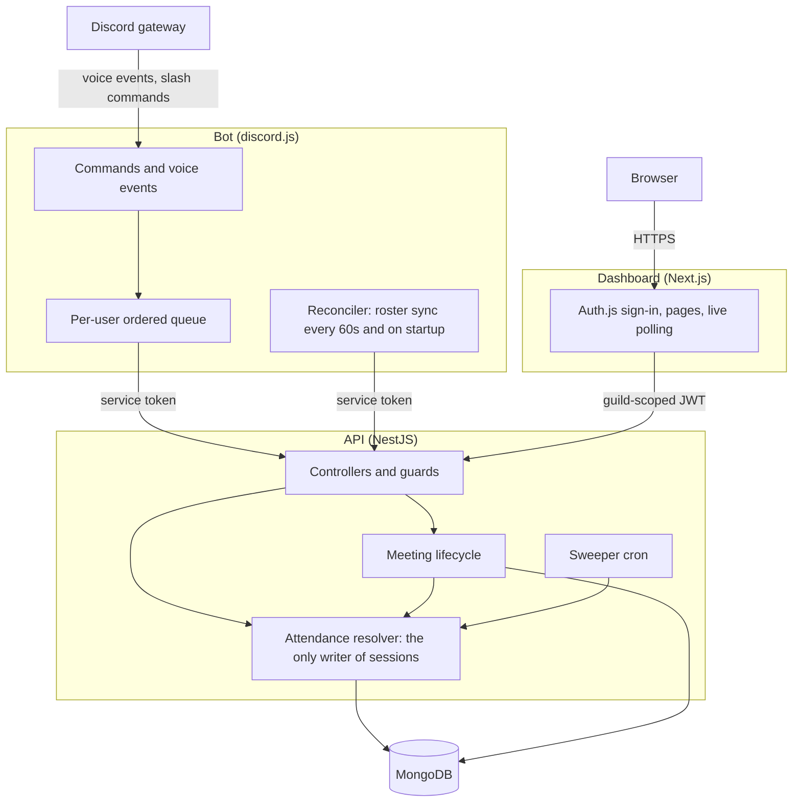
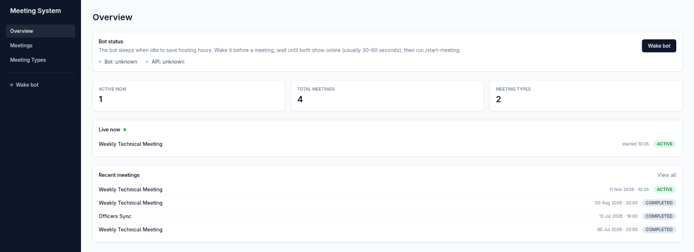
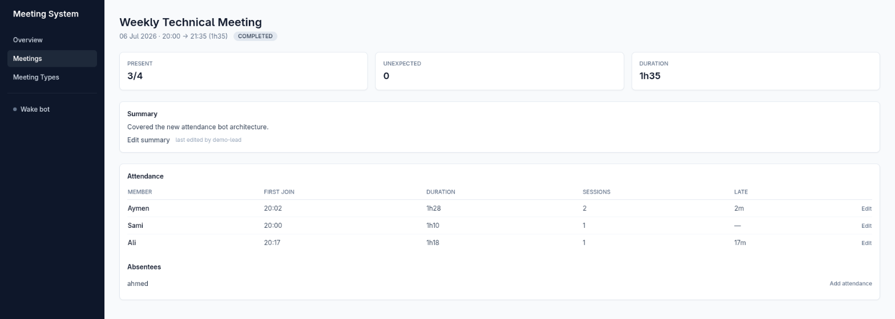

# Meeting System



[](https://github.com/sedky02/gdgc-attendance-bot/actions/workflows/ci.yml)

Club leads lose the first minutes of every meeting taking attendance by hand, and the record ends up in a spreadsheet nobody maintains. Meeting System takes attendance from the Discord voice channel the club is already sitting in. A lead runs `/start-meeting`; the bot records who was there, when each person arrived, how long they stayed and how often they dropped out, then posts a report when the meeting ends. A web dashboard shows live and past meetings and lets a lead correct the record. It was built for a university developer club (GDGC) and works for any Discord server that holds meetings in voice.



*The meeting page while a meeting is running. It refreshes every five seconds; a green dot marks who is in the channel right now.*

## Key features

- **Automatic attendance from voice presence.** Joins, leaves and channel moves become timed sessions per member, with lateness and total time derived from them.
- **Self-correcting records.** Discord events get lost when a bot restarts or a connection drops. Every live meeting is re-synced against the real channel roster every 60 seconds and on bot startup, through the same idempotent code path as the events.
- **Expected members and absentees.** A meeting type names the Discord roles expected to attend. The member list is snapshotted when the meeting starts, so later role changes never rewrite history.
- **Meeting lifecycle in Discord.** Nine slash commands: create, edit and delete meeting types; start, pause, resume, end and cancel meetings; show live status.
- **Dashboard.** Live meeting view, meeting history, frozen reports, meeting summaries, and manual corrections with the editor recorded.
- **Abandoned-meeting sweeper.** A meeting whose channel has been empty for 15 minutes, or that has run 12 hours, is ended automatically with its report intact.
- **Try it without Discord.** A demo mode signs you into the dashboard over seeded data, and a simulator plays the bot's part against the real API.

## Architecture



Three apps in one pnpm/Turborepo workspace, sharing one `packages/contracts` package of Zod schemas:

| Package | Stack | Role |
|---|---|---|
| `apps/api` | NestJS 10, Mongoose, MongoDB | Owns all business logic and the only database connection |
| `apps/bot` | discord.js 14 | Receives commands and voice events, calls the API, renders embeds. Has no database access |
| `apps/dashboard` | Next.js 14 (App Router), Auth.js, TanStack Query, Tailwind | Live view, history, corrections |
| `tests/e2e` | Vitest, mongodb-memory-server | Runs the built API as a process with the bot's real reconciler and a fake gateway |

Design detail (data model, resolver rules, state machine, API reference, invariants) is in [docs/design.md](docs/design.md).

## Quick start (no Discord account needed)

Requires Node 20+, pnpm 9 and Docker. Ports 3000, 3001 and 27017 must be free.

```bash
git clone https://github.com/sedky02/gdgc-attendance-bot.git && cd gdgc-attendance-bot
pnpm install
pnpm build
docker compose -f infra/docker-compose.yml up -d --wait   # MongoDB on :27017
pnpm demo:setup                                           # writes local env files with generated secrets
pnpm --filter api seed                                    # 2 meeting types, 3 past meetings
pnpm demo                                                 # API on :3001, dashboard on :3000
```

Open <http://localhost:3000> and choose **Continue with demo data**. You are signed in as a manager of the seeded server and can browse past meetings, edit a summary, and correct attendance.

To watch a meeting happen live, run the simulator in a second terminal:

```bash
pnpm --filter api demo:live
```

It starts a meeting through the API, replays 25 minutes of earlier joins and leaves, then sends a new voice event every ten seconds. Open the live meeting from the Overview page and watch the table update. Press Ctrl-C in the simulator to end the meeting and freeze its report.

The simulator sends the same requests the bot sends (`POST /internal/voice-events`, `POST /meetings/:id/attendance/sync`) with the same service token. The bot process itself is not part of the demo, because it needs a Discord token.

Interactive API docs are at <http://localhost:3001/docs>.

`pnpm demo:setup` refuses to overwrite existing env files. Demo sign-in only exists when the dashboard runs with `DEMO_MODE=true` outside a production build.

| Overview | A completed meeting |
|---|---|
|  |  |

## Running it against Discord

1. Create an application in the Discord Developer Portal. Under **Bot**, enable the **Server Members Intent**. The code uses the `Guilds`, `GuildVoiceStates` and `GuildMembers` intents.
2. Invite the bot with scopes `bot` and `applications.commands` and the permissions View Channels, Send Messages, Embed Links, Read Message History and Connect.
3. Under **OAuth2**, add the redirect `http://localhost:3000/api/auth/callback/discord`.
4. Create the env files and fill them in (see [Configuration](#configuration)):

   ```bash
   cp apps/api/.env.example apps/api/.env
   cp apps/bot/.env.example apps/bot/.env
   cp apps/dashboard/.env.example apps/dashboard/.env.local
   ```

5. Register the slash commands and start everything:

   ```bash
   pnpm build
   pnpm --filter bot deploy-commands
   pnpm dev
   ```

Set `DISCORD_DEV_GUILD_ID` during development: guild commands register instantly, global ones can take an hour. Re-run `deploy-commands` after changing any command definition.

### Commands

| Command | Who | What it does |
|---|---|---|
| `/create-meeting-type` | manager | Creates a meeting type: a name plus the roles expected to attend |
| `/edit-meeting-type` | manager | Edits the name and roles. Affects future meetings only |
| `/delete-meeting-type` | manager | Archives a type so it can no longer start meetings. Past meetings keep their records |
| `/start-meeting` | manager | Starts a meeting in your current voice channel, snapshots expected members, opens sessions for whoever is present |
| `/pause-meeting` | manager | Pauses the meeting and closes every open session |
| `/resume-meeting` | manager | Resumes and opens new sessions for whoever is in the channel |
| `/end-meeting` | manager | Closes sessions, freezes stats, posts the attendance report |
| `/cancel-meeting` | manager | Closes sessions and marks the meeting cancelled, with a reason. The record is kept |
| `/meeting-status` | anyone | Shows who is in the live meeting |

Manager commands default to members with the **Manage Events** permission; a server admin can change that per command in Discord. The dashboard applies the same rule: anyone in the server can read, only members with Manage Events (or Administrator, or the owner) can edit.

## Configuration

**`apps/api/.env`**

| Variable | Required | Purpose |
|---|---|---|
| `MONGODB_URI` | yes | MongoDB connection string |
| `JWT_SECRET` | yes | At least 32 characters. Must equal the dashboard's `API_JWT_SECRET` |
| `BOT_SERVICE_TOKEN` | yes | At least 32 characters. Must equal the bot's `BOT_SERVICE_TOKEN` |
| `CORS_ORIGIN` | yes | The dashboard's origin |
| `PORT` | no | Defaults to 3001 |
| `NODE_ENV` | no | `development`, `test` or `production` |
| `SWAGGER_ENABLED` | no | `true` or `false`. Defaults to on, except in production |
| `BOT_HEALTH_URL`, `API_PUBLIC_URL` | no | Keep-alive targets for hosts that suspend idle services. See [docs/deployment.md](docs/deployment.md) |

**`apps/bot/.env`** (there is deliberately no database URI)

| Variable | Required | Purpose |
|---|---|---|
| `DISCORD_TOKEN` | yes | Bot token |
| `DISCORD_APPLICATION_ID` | yes | Application id, used to register commands |
| `API_BASE_URL` | yes | For example `http://localhost:3001/api/v1` |
| `BOT_SERVICE_TOKEN` | yes | Matches the API |
| `DISCORD_DEV_GUILD_ID` | no | Register commands to one guild for instant updates |
| `RECONCILE_INTERVAL_MS` | no | Roster sync interval. Defaults to 60000 |
| `PORT` | no | Port of the bot's keep-alive HTTP endpoint. Defaults to 3002 |

**`apps/dashboard/.env.local`**

| Variable | Required | Purpose |
|---|---|---|
| `NEXTAUTH_URL` | yes | The dashboard's own URL |
| `NEXTAUTH_SECRET` | yes | Session encryption secret |
| `API_JWT_SECRET` | yes | Equals the API's `JWT_SECRET` |
| `NEXT_PUBLIC_API_URL` | yes | For example `http://localhost:3001/api/v1` |
| `DISCORD_CLIENT_ID`, `DISCORD_CLIENT_SECRET` | yes, unless demo mode | Discord OAuth application |
| `DISCORD_BOT_TOKEN` | yes, unless demo mode | Same token as the bot. Used to list the guilds the bot is in |
| `DEMO_MODE` | no | `true` adds the demo sign-in. Ignored in production builds |
| `BOT_HEALTH_URL`, `API_HEALTH_URL` | no | Targets for the **Wake bot** button |

The dashboard is multi-tenant. After Discord sign-in a user sees only the servers where they are a member and the bot is installed; with more than one, they pick at `/select-guild`.

## Testing

```bash
pnpm lint
pnpm typecheck
pnpm test
```

`pnpm test` runs 215 tests: 130 for the API, 63 for the bot, 21 for the dashboard and one end-to-end scenario. API tests run against `mongodb-memory-server`, so the real indexes and atomic updates are exercised; Mongoose is never mocked.

What the tests establish:

- **Resolver correctness under concurrency.** Twenty concurrent joins for one member produce one session. A departure racing another member's join never closes the newcomer. Late or replayed observations change nothing.
- **Lifecycle rules.** A session never spans a pause. A second start on a channel that already has a live meeting gets a clean 409. Stats frozen at the end equal the live calculation at that instant.
- **Sweeper.** An abandoned meeting is ended, backdated to its last activity, with sessions closed and stats frozen.
- **Bot outage recovery, end to end** ([tests/e2e](tests/e2e/src/bot-outage-recovery.spec.ts)). The built API runs as a real process against MongoDB. The bot's real voice handler, queue and reconciler run against a fake gateway. A meeting starts, the bot is stopped while members leave and join, the test confirms the record is stale, then a fresh bot instance starts and after its single startup reconcile the open sessions equal the channel roster.
- **Security rules.** Tokens are redacted from request logs. A dashboard token cannot touch another guild's data, cannot write without the manager claim, and cannot forge the editor's name.

CI ([.github/workflows/ci.yml](.github/workflows/ci.yml)) runs lint, typecheck, tests, the build, and both Docker image builds on every push and pull request.

## Design decisions and trade-offs

- **Attendance is reconciled state, not an event log.** Events give precise timestamps; the periodic roster sync guarantees the record converges. Both call one idempotent resolver. The cost is that a session reconstructed by sync can be off by up to one sync interval, so each session records whether an event or a sync wrote it.
- **The bot never touches the database.** Every rule lives in the API, where it can be tested without Discord. The cost is an HTTP hop per event, absorbed by a bounded, per-user ordered queue with retries.
- **Invariants are enforced by indexes.** "One live meeting per channel" and "one attendance record per member per meeting" are unique indexes, and session opens are single conditional upserts. Check-then-write in application code loses to concurrent voice events.
- **Timestamps come from the observer.** The resolver never reads the clock, so a retried request cannot shift a record, and the demo simulator can legitimately replay history.
- **History is snapshotted.** Usernames, role names and the expected-member list are copied at write time. Discord ids are the only references.
- **No Redis, no queue.** One bot instance and an in-process cron are enough at club scale. Sharding would require putting the reconciler behind a lock.
- **One contracts package.** Zod schemas define the API payloads, the bot's and dashboard's parsing, and the OpenAPI document, so they cannot drift.

## Known limitations

- A member who leaves and returns entirely within a bot outage is recorded as having stayed. Roster sync can only see who is present when it runs. The end-to-end test asserts this behaviour explicitly.
- Sessions closed or opened by sync are accurate only to the sync interval (60 seconds by default).
- Exactly one bot instance may run. There is no sharding and no leader election.
- Dashboard permissions are read at sign-in. A change to someone's Discord permissions takes effect when they next sign in.
- Editing an attendee in the dashboard replaces their sessions with a single session from the entered start to the entered end.
- The API has no rate limiting. It relies on the service token, guild-scoped JWTs and the platform's TLS.
- The sweeper's thresholds (15 minutes empty, 12 hours maximum) are constants, not configuration.
- Slash-command flows are covered by unit tests with mocked interactions. Nothing in the automated suite talks to the real Discord gateway.
- On a host that suspends idle services, the bot must be woken before a meeting starts. See [docs/deployment.md](docs/deployment.md).
- Not built: scheduling and reminders, excuse handling, spreadsheet export, per-member trends.

## Deployment

The API and bot run as Docker web services on Render; the dashboard runs on Vercel; the database is MongoDB Atlas. Both images run as a non-root user and define healthchecks. Details, the free-tier keep-awake setup, upgrade notes and a single-VM Docker Compose alternative are in [docs/deployment.md](docs/deployment.md).

## Project layout

```text
apps/api          NestJS API: meetings, attendance (resolver, stats), meeting types, reports, internal
apps/bot          discord.js bot: commands, voice events, reconciler, event queue, embeds
apps/dashboard    Next.js dashboard
packages/         contracts (Zod schemas), shared eslint and tsconfig
tests/e2e         bot outage recovery scenario
infra/            Dockerfiles, dev and production Compose files, Caddyfile
docs/             design.md, deployment.md, BUILD_PLAN.md, architecture.md (original spec, historical)
```

## License

No license has been chosen yet. Until one is added, all rights are reserved.
